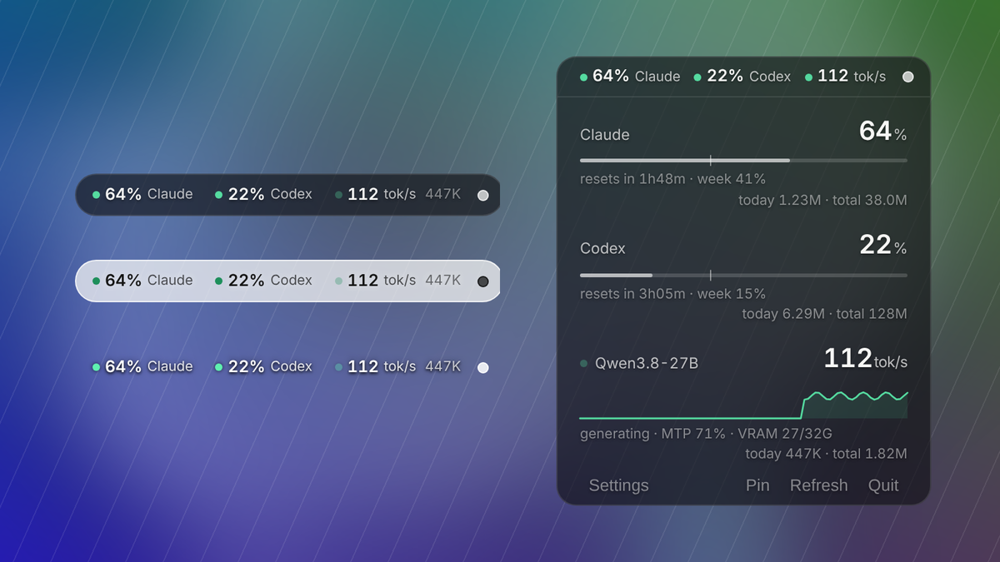
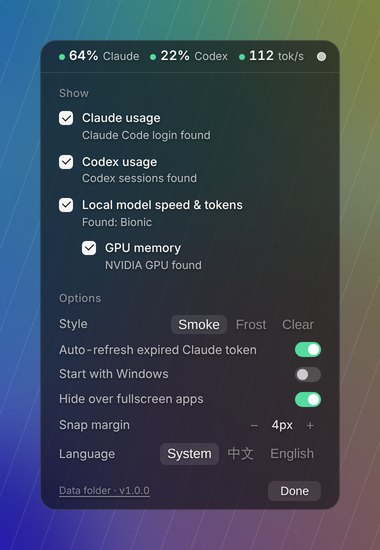

# AI Usage Widget

[](https://github.com/Atetra2007/ai-usage-widget/releases/latest)
[](https://github.com/Atetra2007/ai-usage-widget/releases)

[](LICENSE)

English | [中文](README.md) · [Download the latest version](https://github.com/Atetra2007/ai-usage-widget/releases/latest) · [Changelog](CHANGELOG.md)

A tiny transparent pill on your Windows desktop that shows your **Claude** and **Codex** usage limits, plus the generation speed and token usage of your **local LLM** (Bionic / LM Studio). Hover to expand; it warns you before you run out and suggests where to go next.



## Features

- **Claude / Codex limits**: 5-hour and weekly usage, reset countdown, tokens today and in total. A thin tick on each bar marks where you'd be at an even pace — past it means you're burning fast, with a forecast of when you'll run out.
- **Multiple Codex accounts**: if you switch between Codex accounts on one PC, each account's limits are tracked separately (the signed-in account on top, the others listed below), and it suggests switching when another account has room.
- **Local model**: live speed while generating (zero when idle), a 90-second speed chart, MTP acceptance, VRAM, tokens today and in total.
- **Auto-detect + choose what to show**: on first launch it finds the tools you have; only checked items appear. With a single item the pill shows extra detail.
- **Smart alerts**: when a limit is almost out, it suggests your local model or the other service if it has room.
- **Three transparent styles**: Smoke, Frost, Clear (text only).
- **Edge snapping**: release a drag near an edge, corner or the middle of the top/bottom edge and it snaps there.
- **Two modes** via the small dot on the pill: filled = expand on hover, hollow = pill only (easy dragging).
- Hides over fullscreen apps, stays out of the taskbar, optional start with Windows, English and Chinese UI.



## Install

1. Download the latest `AIUsageWidget-vX.Y.Z-win-x64.zip` from [Releases](../../releases)
2. Unzip anywhere (e.g. `D:\Apps\AIUsageWidget`)
3. Run `AIUsageWidget.exe` — the first launch opens settings so you can pick what to show

> The exe is not code-signed. If SmartScreen says "Windows protected your PC", click "More info" → "Run anyway".

Requirements: Windows 11 (Windows 10 works but transparency may look different) and the WebView2 runtime (built into Windows 11).

## Data sources

| Item | What you need |
|---|---|
| Claude limits | Install [Claude Code](https://docs.claude.com/en/docs/claude-code/setup) and log in once with your Pro / Max subscription. The widget reads its login to query usage; you don't need to keep using Claude Code. |
| Claude tokens today | Counts Claude Code usage only (claude.ai / desktop chats aren't logged locally; the limit percentage is shared across all of them). |
| Codex | Install and sign in to Codex (CLI or app); sessions appear after first use. Weekly-only plans are shown as a weekly limit. By default the widget also uses your Codex login to query live usage (turn off "Live Codex usage" in settings). |
| Local model | Run a GGUF model with [LM Studio Bionic](https://lmstudio.ai) or LM Studio. Other llama.cpp servers: add their log folder to `local_log_dirs` in `settings.json`. |
| VRAM | NVIDIA GPU (via `nvidia-smi`). |

## FAQ

- **Claude shows "usage API HTTP 401" or "token expired"**: run `claude` once in a terminal to log in again. Turning on "Auto-refresh expired Claude token" in settings makes this rarer.
- **The local speed says "est."**: llama.cpp's `/slots` endpoint isn't reachable (Bionic's built-in server needs a key), so while generating the widget shows the average of recent replies and switches to the real speed when each reply finishes.
- **The widget disappeared**: it hides over fullscreen games and videos and comes back when you leave fullscreen. If it never comes back, it may have quit: start it again, and attach `error.log` from the data folder if you report the problem.
- **Antivirus or SmartScreen blocks it**: the exe isn't code-signed. Check the download against the SHA256 on the release page, or run from source.
- **I use several Codex accounts**: the widget reads `~/.codex/auth.json` to know which account is signed in, and tells the accounts' log entries apart by their limit reset times, so switching accounts no longer mixes their usage. With an account switcher such as Cockpit Tools, cc-switch or codex-switch, it finds the other saved accounts and queries their live usage too; otherwise other accounts show their usage as of their last use. If your switcher stores accounts elsewhere, add the file or folder to `codex_auth_files` in `settings.json`. Name accounts with `codex_labels`, e.g. `{"me@example.com": "Main"}`.
- **Port 8765 is already in use**: change `http_port` in `settings.json`, or set `http_enabled` to `false`.

## Privacy & notes

- **Everything stays on your PC.** There are only two network calls: the Claude usage query to `api.anthropic.com` and the Codex usage query to `chatgpt.com` (the same endpoint Codex's `/status` uses). No telemetry.
- The Codex usage query only reads login tokens. It never refreshes or rewrites `auth.json` or any switcher file, and tokens are never written to the widget's data (`codex_accounts.json` only keeps account emails and usage). Turn off "Live Codex usage" in settings to use local session logs only, or set `codex_other_accounts` to `false` in `settings.json` to skip switcher accounts.
- Claude and Codex usage come from **undocumented endpoints** used by their official clients; they may change or stop working.
- When the access token expires, the widget refreshes it the way Claude Code does and writes it back to `~/.claude/.credentials.json` (backed up to `.credentials.json.bak` first). Rarely, refreshing at the same moment as Claude Code may require logging in again. You can turn this off in settings; you'll then be asked to run `claude` once when the token expires.
- Exact live token speed needs llama.cpp's `/slots` endpoint. Bionic's built-in server requires a key, so while generating the widget shows the average of recent replies (marked "est.") and updates with the real speed when each reply finishes.
- Not affiliated with Anthropic, OpenAI or LM Studio.

## Where data lives

- exe: `%LOCALAPPDATA%\AIUsageWidget` (settings, window position, daily history, logs). Put an empty `portable.txt` next to the exe for portable mode (data in `data\` next to it).
- Source: `data\` in the repo (git-ignored).
- Local JSON endpoint: `http://127.0.0.1:8765/status.json` (`http_lan: true` in `settings.json` to expose it on your LAN).

## Run from source / build

Python 3.11–3.13 (pythonnet, used by pywebview, doesn't support 3.14 yet).

```bat
setup_dev.bat      :: create .venv and install requirements
start_widget.bat   :: run (no console)
debug_widget.bat   :: run with console and devtools
build_exe.bat      :: build with PyInstaller into dist\AIUsageWidget\
```

To release: bump `VERSION` in `app/main.py`, add a section for it at the top of `CHANGELOG.md`, then run `publish.bat`. It commits, pushes and tags `v*`; GitHub Actions then builds the zip and uses that CHANGELOG section as the release notes (`.github/workflows/release.yml`).

To add a data source, write a module in `app/providers/` with a `detect()` function and a collector class, then register it in `settings.py` and the UI.

## License

[MIT](LICENSE)
