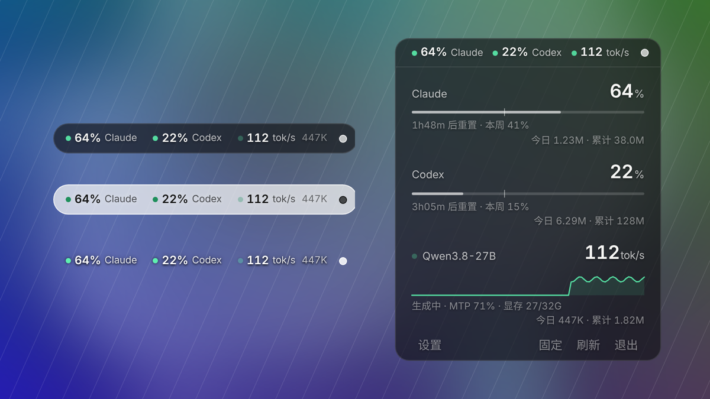
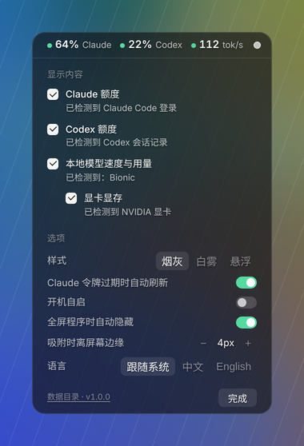

# AI Usage Widget · AI 用量小组件

[](https://github.com/Atetra2007/ai-usage-widget/releases/latest)
[](https://github.com/Atetra2007/ai-usage-widget/releases)

[](LICENSE)

[English](README.en.md) | 中文 · [下载最新版](https://github.com/Atetra2007/ai-usage-widget/releases/latest) · [更新日志](CHANGELOG.md)

Windows 桌面上的一条透明小胶囊，实时显示 **Claude**、**Codex** 的剩余额度，以及**本地大模型**（Bionic / LM Studio）的生成速度和 token 用量。鼠标移上去展开详情，额度快用完时提醒你换个工具。



## 功能

- **Claude / Codex 额度**：5 小时窗口和每周额度、重置倒计时、今日和累计 token。进度条上的细竖线表示按时间均匀消耗应在的位置，越过它说明用快了，还会预测什么时候用完。
- **本地模型**：生成时显示速度、空闲时归零，最近 90 秒速度曲线，MTP 接受率，显存占用，今日和累计 token。
- **自动识别 + 手动勾选**：第一次启动自动检测你装了哪些工具，只显示勾选的项目；只勾一项时胶囊会显示更多细节。
- **智能提醒**：快用完时，有本地模型就提示「简单任务交给本地」，同时有 Claude 和 Codex 就提示另一个还剩多少。
- **三种透明样式**：烟灰、白雾、悬浮（全透明，只有文字）。
- **贴边吸附**：拖动松手后自动吸附到屏幕边缘、四角或上下边中间。
- **两种模式**：胶囊右侧小圆点切换。实心是悬停展开，空心是只显示胶囊（方便拖动）。
- 全屏游戏/视频时自动隐藏，不占任务栏，可开机自启，中英双语。



## 安装

1. 到 [Releases](../../releases) 下载最新的 `AIUsageWidget-vX.Y.Z-win-x64.zip`
2. 解压到任意文件夹（比如 `D:\Apps\AIUsageWidget`）
3. 双击 `AIUsageWidget.exe`，第一次会弹出设置，确认要显示的内容即可

> exe 没有代码签名，第一次运行 Windows 可能提示「Windows 已保护你的电脑」：点「更多信息」→「仍要运行」。

系统要求：Windows 11（Windows 10 也能用，但透明效果可能不同）；需要 WebView2 运行时（Win11 自带）。

## 让各项数据出现

| 项目 | 需要什么 |
|---|---|
| Claude 额度 | 安装 [Claude Code](https://docs.claude.com/en/docs/claude-code/setup)，用订阅账号（Pro / Max）登录一次。小组件读取它的登录凭证查询额度，之后不用 Claude Code 也行。 |
| Claude 今日 token | 只统计 Claude Code 的用量（网页版 / 桌面版聊天的 token 本地没有记录；额度百分比不受影响，是所有入口共用的）。 |
| Codex | 安装并登录 Codex（CLI 或 App），用过一次就会有会话记录。只有每周额度的套餐会显示为「每周额度」。 |
| 本地模型 | 用 [LM Studio Bionic](https://lmstudio.ai) 或 LM Studio 跑 GGUF 模型。其他 llama.cpp 服务器可在 `settings.json` 的 `local_log_dirs` 里加日志目录。 |
| 显存 | NVIDIA 显卡（通过 `nvidia-smi`）。 |

## 用法

- 鼠标悬停展开，移开 2.5 秒后收起；「固定」让卡片一直展开。
- 胶囊最右的小圆点：实心 = 悬停展开，空心 = 只显示胶囊。
- 拖动胶囊移动位置，松手自动吸附（离边距离在设置里调，吸附距离在 `settings.json` 的 `snap_distance`）。
- 放在屏幕下半边时向上展开，右半边时固定右边缘。
- 「设置」里可以勾选显示内容、换样式、开机自启、换语言。

## 常见问题

- **Claude 显示「额度接口 HTTP 401」或「令牌已过期」**：在终端运行一次 `claude` 重新登录即可；设置里打开「Claude 令牌过期时自动刷新」可以少遇到。
- **本地模型速度后面写着「估算」**：读不到 llama.cpp 的 `/slots` 接口（Bionic 内置服务器需要密钥），生成中先显示最近几次的平均速度，每条回复结束后更新为真实速度。
- **小组件不见了**：全屏玩游戏 / 看视频时会自动隐藏，退出全屏就回来。如果一直不出现，可能是程序退出了：重新打开它；反馈问题时请附上数据目录里的 `error.log`。
- **杀毒软件或 SmartScreen 拦截**：exe 没有代码签名。可以用 Release 页面上的 SHA256 核对下载的文件，或者从源码运行。
- **端口 8765 被占用**：在 `settings.json` 里改 `http_port`，或把 `http_enabled` 设为 `false`。

## 隐私与说明

- **所有数据都在你的电脑上。** 唯一的网络请求是向 Anthropic 查询 Claude 额度（`api.anthropic.com`）。没有任何统计上报。
- Claude 额度用的是 Claude Code 内部使用的**非公开接口**，随时可能变化或失效。
- 访问令牌过期时，小组件默认按 Claude Code 的方式刷新并写回 `~/.claude/.credentials.json`（写前会备份为 `.credentials.json.bak`）。极少数情况下和 Claude Code 同时刷新可能需要重新登录一次；不想要可以在设置里关掉，关掉后令牌过期时会提示你运行一次 `claude`。
- 本地模型的逐字实时速度需要读取 llama.cpp 的 `/slots` 接口；Bionic 的内置服务器需要密钥，读不到时生成中显示的是最近几次的平均速度（标注「估算」），每条回复结束后用真实速度更新。
- 本项目与 Anthropic、OpenAI、LM Studio 无关。

## 数据位置

- exe 版：`%LOCALAPPDATA%\AIUsageWidget`（设置 `settings.json`、窗口位置、每日用量历史、日志）。在 exe 旁边放一个空的 `portable.txt` 就改为便携模式，数据存在 exe 旁的 `data\`。
- 源码版：仓库里的 `data\`（已在 .gitignore 里）。
- 本机 JSON 接口：`http://127.0.0.1:8765/status.json`（`settings.json` 里 `http_lan: true` 可让局域网设备访问）。

## 从源码运行 / 打包

需要 Python 3.11–3.13（pywebview 依赖的 pythonnet 暂不支持 3.14）。

```bat
setup_dev.bat      :: 在仓库里建 .venv 并安装依赖
start_widget.bat   :: 启动（无控制台）
debug_widget.bat   :: 带控制台和开发者工具启动
build_exe.bat      :: 用 PyInstaller 打包到 dist\AIUsageWidget\
```

发布新版本：改 `app/main.py` 里的 `VERSION`，在 `CHANGELOG.md` 顶部写好这个版本的更新内容，然后双击 `publish.bat`。它会提交、推送并打上 `v*` 标签，GitHub Actions 随后自动打包，用 CHANGELOG 里对应的段落作为 Release 说明（见 `.github/workflows/release.yml`）。

代码结构：

```
app/
  main.py          采集调度、窗口、透明/吸附/全屏隐藏
  settings.py      设置、自动识别、开机自启
  paths.py         资源与数据目录
  providers/       每个数据来源一个模块（claude / codex / local / gpu）
  ui/index.html    界面（含中英文案）
```

想加新的数据来源：在 `providers/` 里写一个带 `detect()` 和采集类的模块，再在 `settings.py` 和界面里注册即可。

## 许可

[MIT](LICENSE)
